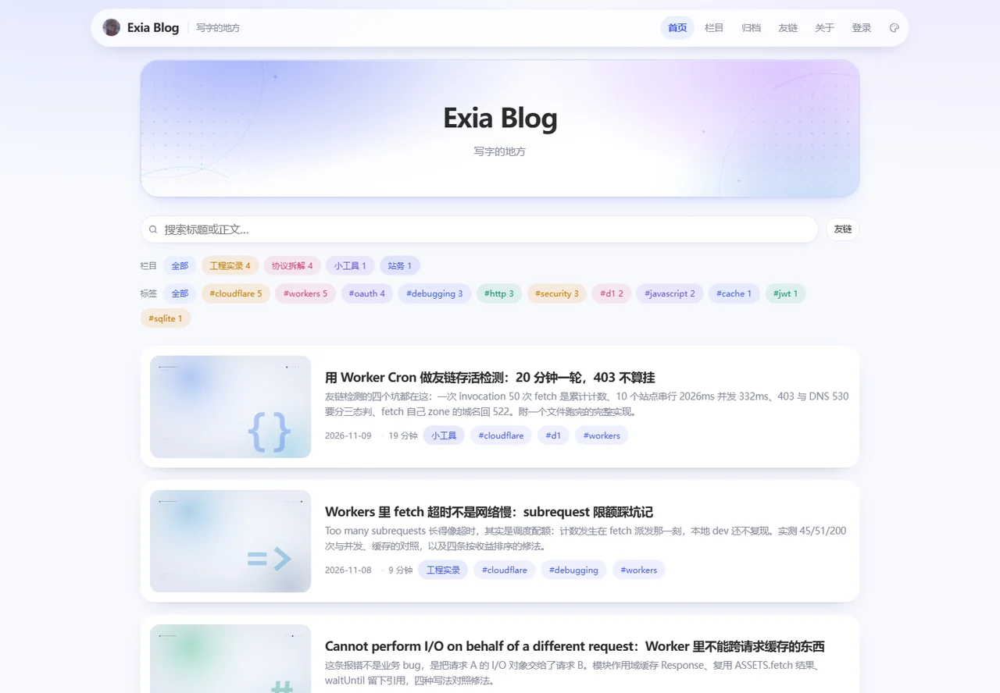

## Exia

**在 Cloudflare 边缘上手写一个博客系统。没有框架，没有服务器，没有备案。**

[博客](https://exia.de5.net/) · [全部文章](https://exia.de5.net/archive) · [RSS](https://exia.de5.net/rss.xml) · [关于](https://exia.de5.net/about)

 

## 在做

[**exia-blog**](https://github.com/Exia-blip/exia-blog) — 跑在 Cloudflare Workers + D1 + R2 上的博客系统。一个文件一个职责，从路由到 Markdown 渲染到友链巡检全是手写的。

| | |
|---|---|
| **渲染** | Worker 端整页 SSR，前端只 hydrate 不重建 DOM。Markdown 渲染器前后端同构，编辑器预览和线上输出逐字一致 |
| **存储** | D1 存文章与评论，R2 存图——SigV4 预签直传，图片不经过 Worker |
| **登录** | GitHub OAuth。第一个登录的用户自动成为管理员，其余是普通用户 |
| **巡检** | Cron 每 20 分钟批量检测友链存活，三态判定：正常 / 有响应但异常 / 完全拿不到响应。403 不算挂 |
| **性能** | 首屏 80KB、LCP 290ms、CLS 0.0004，全部是用 CDP 实测出来的数字，不是估的 |

## 最近写的

都是踩过坑之后写的，附可复现的命令和真实报错原文：

- [用 Worker Cron 做友链存活检测：20 分钟一轮，403 不算挂](https://exia.de5.net/p/worker-cron-friend-check)
- [Workers 里 fetch 超时不是网络慢：subrequest 限额踩坑记](https://exia.de5.net/p/workers-subrequest-limit)
- [wrangler deploy 失败对照：六条报错原文对应的真实原因](https://exia.de5.net/p/wrangler-deploy-errors)
- [D1 报错 no such table 排查实录：本地和远程根本不是一套库](https://exia.de5.net/p/d1-no-such-table)
- [PKCE 补的是哪个洞：code 在回调路上被截走](https://exia.de5.net/p/oauth-pkce)
- [Authorization Code：为什么要绕一个 302 才把 token 给你](https://exia.de5.net/p/oauth-auth-code)

## 技术栈

## 联系

- 博客 — <https://exia.de5.net/>
- 提问 / 报错 — [开个 issue](https://github.com/Exia-blip/exia-blog/issues)
- 订阅 — <https://exia.de5.net/rss.xml>

主页和博客一样：没有统计卡片，没有第三方脚本，没有花活。
